# ELEC 4 – Python Programming

**Name:** Charles Caampued
**Section:** IV-BSIT-A
**Course:** ELEC 4 – Python Programming
**Instructor:** Carl Gustaf Patrik B. Ferrer

Self-paced learning assignment covering the lessons for November 9–20, 2026.

## Activities

| Set | Activity | Description | Folder |
|---|---|---|---|
| 1 | P1 · Student Grade Calculator | Menu-driven program that computes the average, highest, lowest and pass/fail result of a set of grades. | [set1/p1](set1/p1/) |
| 1 | P2 · Custom Module | Uses a custom `student_utils` module and `datetime` to print a dated grade report. | [set1/p2](set1/p2/) |
| 1 | P3 · Student Record Manager | Adds, removes, searches and displays student names using a list and a set. | [set1/p3](set1/p3/) |
| 1 | P4 · Safe Menu Program | Handles invalid numbers, division by zero, missing files and invalid menu choices. | [set1/p4](set1/p4/) |
| 2 | P5 · Student Information File System | Saves, displays, searches and updates student records in `students.txt`. | [set2/p5](set2/p5/) |
| 2 | P6 · Recursion Toolkit | Recursive factorial, Fibonacci, sum and list search. | [set2/p6](set2/p6/) |
| 2 | P7 · Student Management with Classes | `Subject` and `Student` classes with grade validation, grouped by section. | [set2/p7](set2/p7/) |
| 2 | P8 · Inheritance and Polymorphism | `Person` base class with `Student` and `Teacher` subclasses that override `introduce()`. | [set2/p8](set2/p8/) |

## Requirements

- Python 3 (run with `py -3` on Windows)
- No external packages needed

---

# Set 1

## P1 · Student Grade Calculator

```bash
cd set1/p1
py -3 p1_grade_calculator.py
```


## P2 · Custom Module

```bash
cd set1/p2
py -3 p2_main.py
```


## P3 · Student Record Manager

```bash
cd set1/p3
py -3 p3_record_manager.py
```

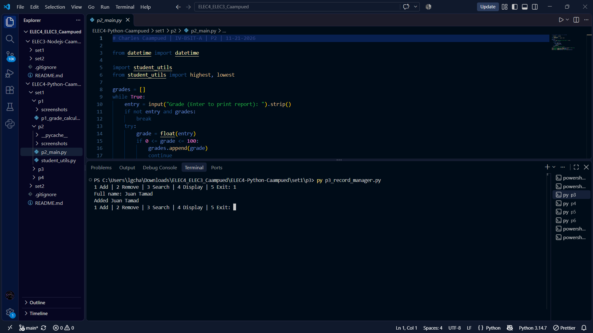
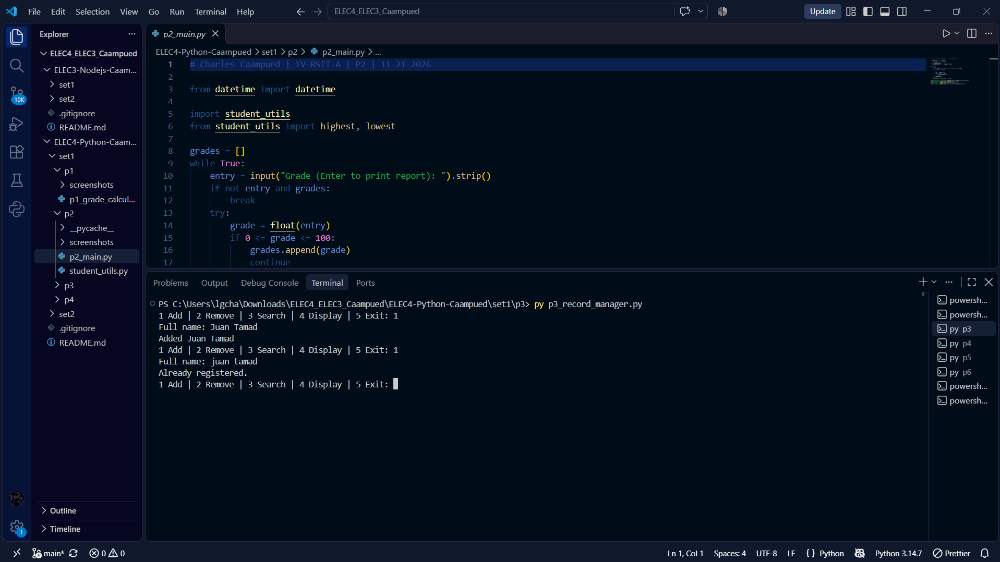
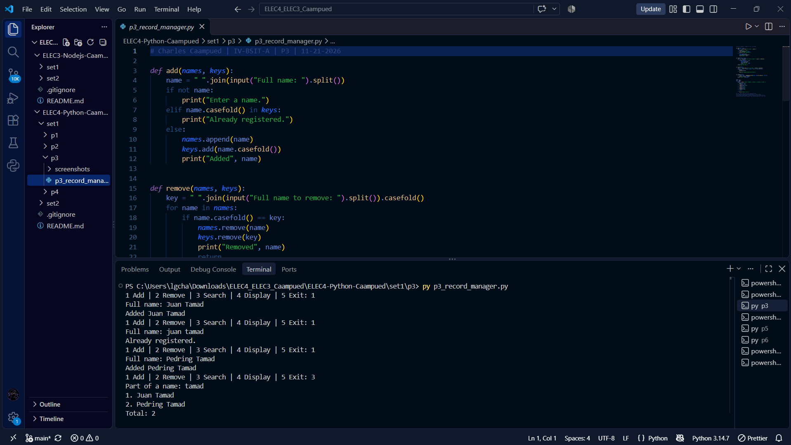
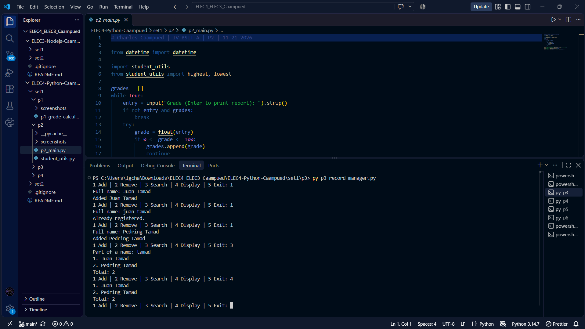
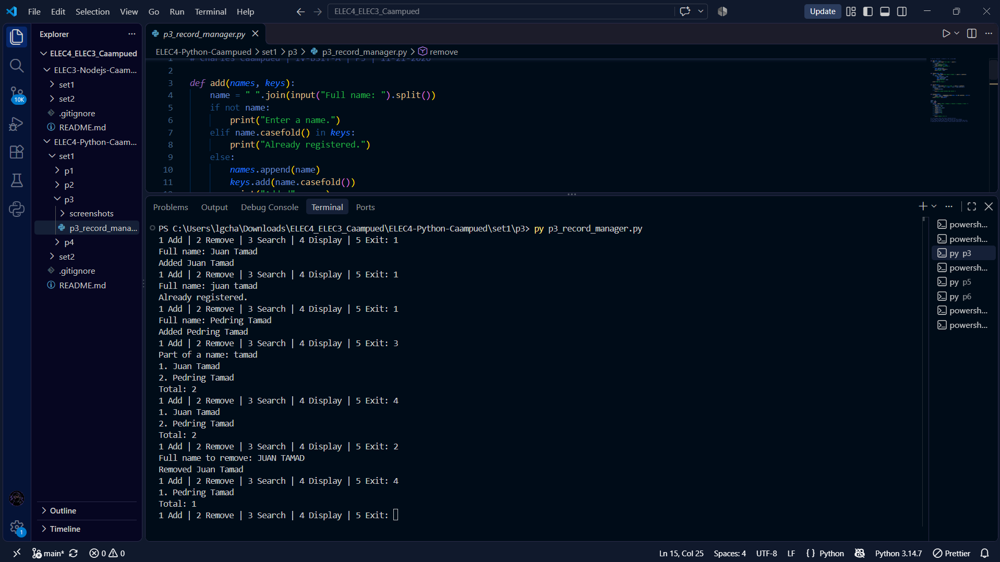

## P4 · Safe Menu Program

```bash
cd set1/p4
py -3 p4_exceptions.py
```

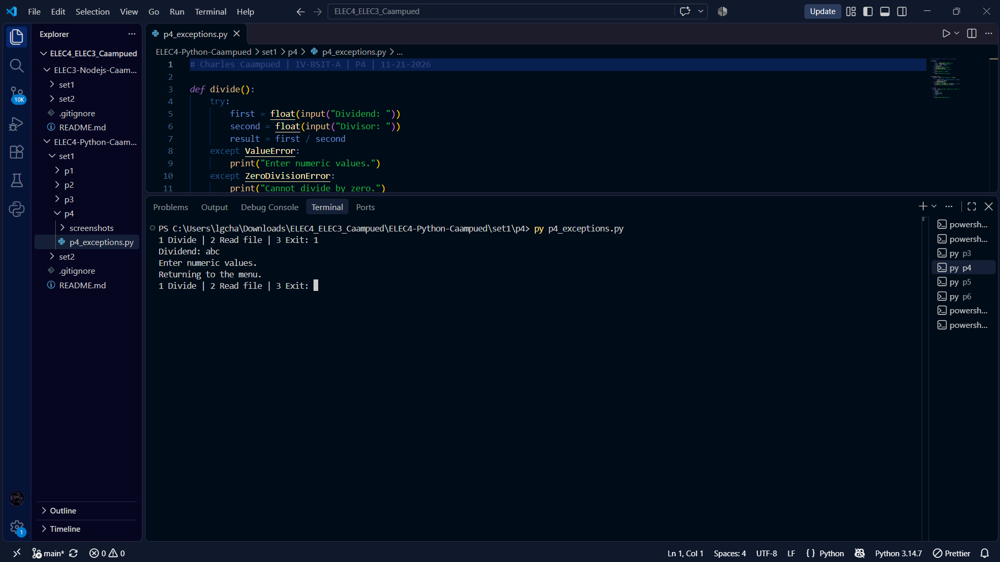
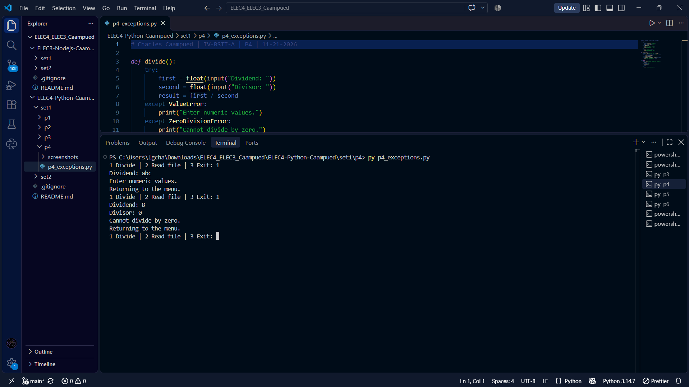
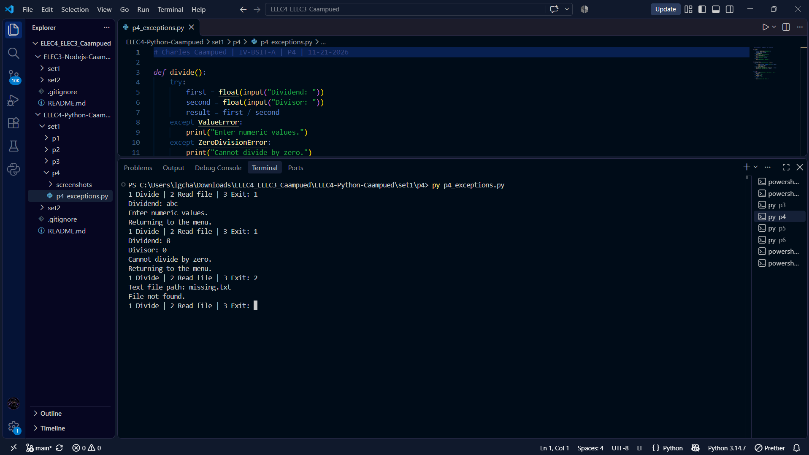
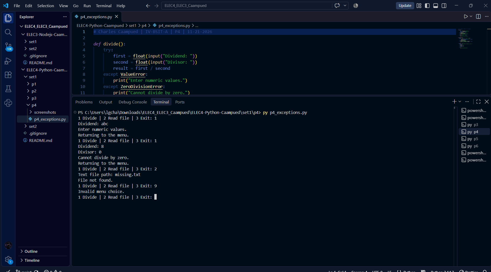

---

# Set 2

## P5 · Student Information File System

```bash
cd set2/p5
py -3 p5_file_system.py
```

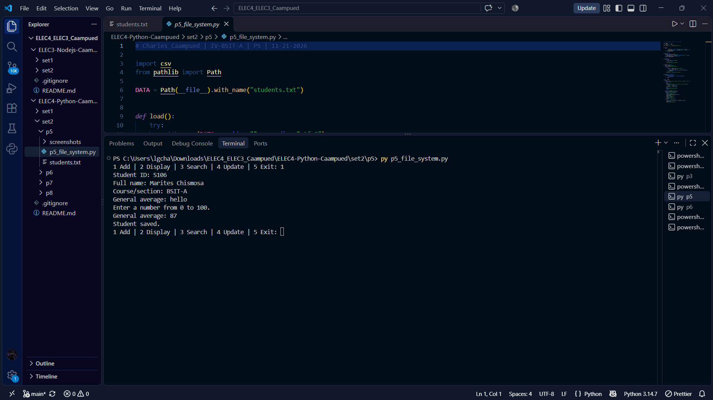
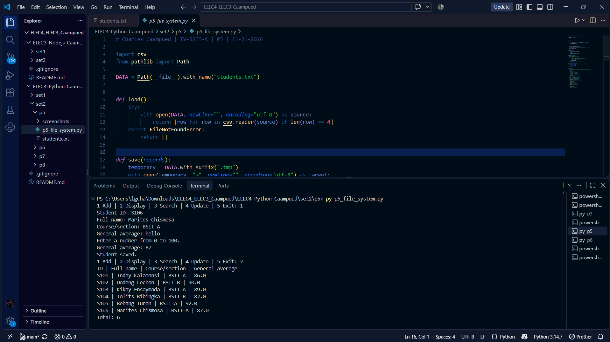
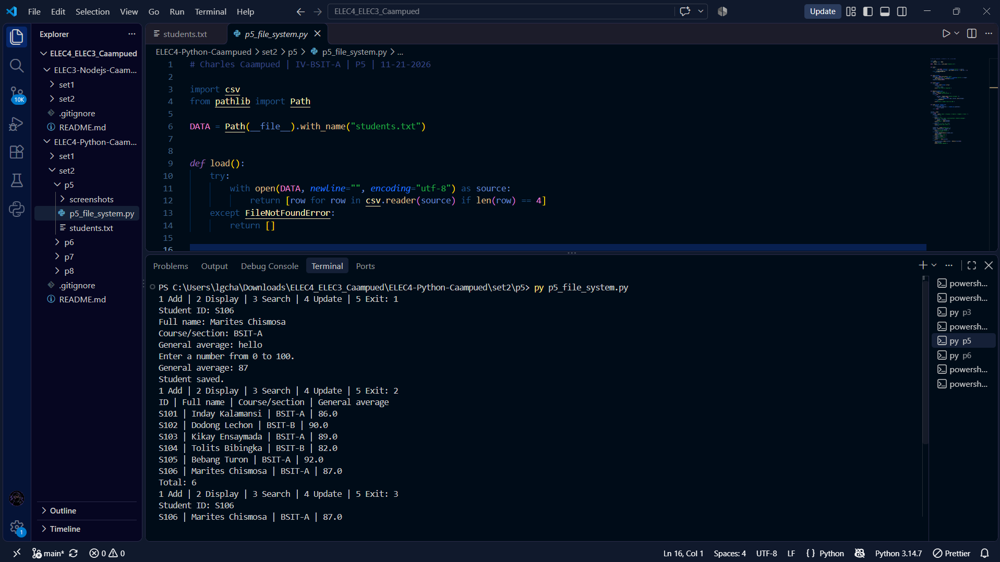
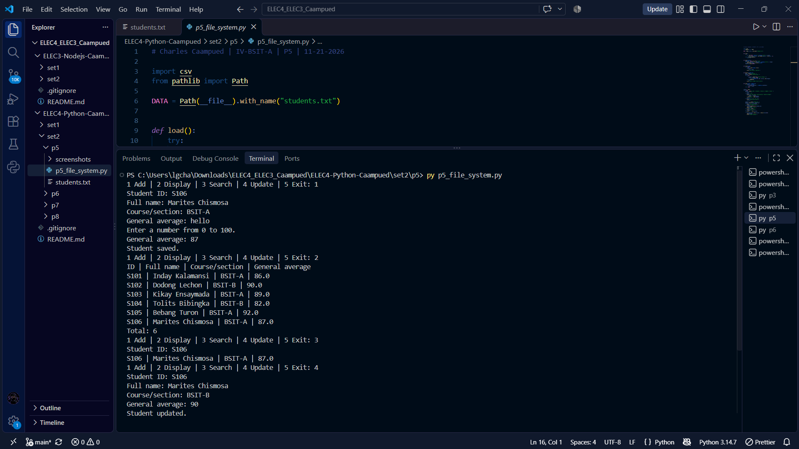

## P6 · Recursion Toolkit

```bash
cd set2/p6
py -3 p6_recursion.py
```


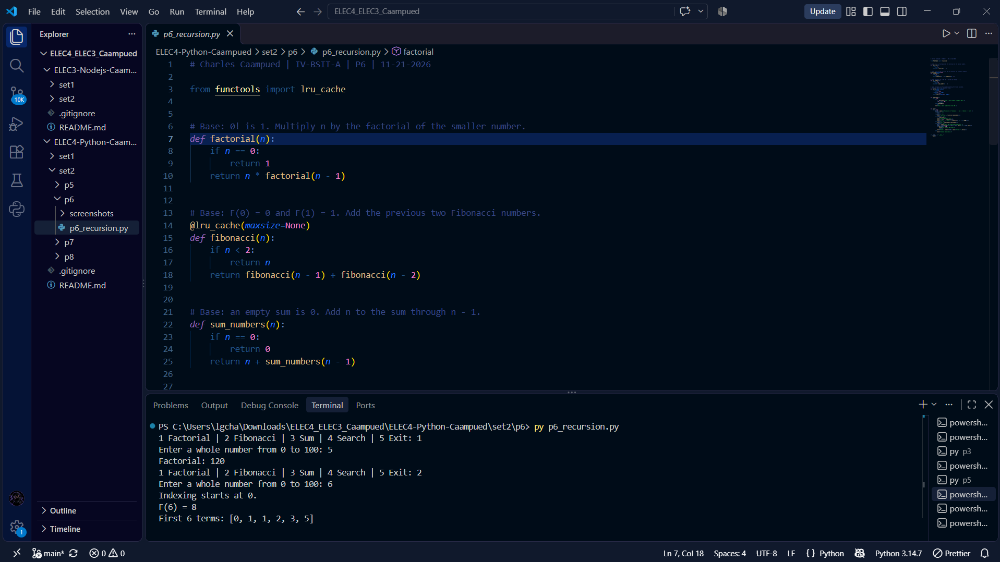
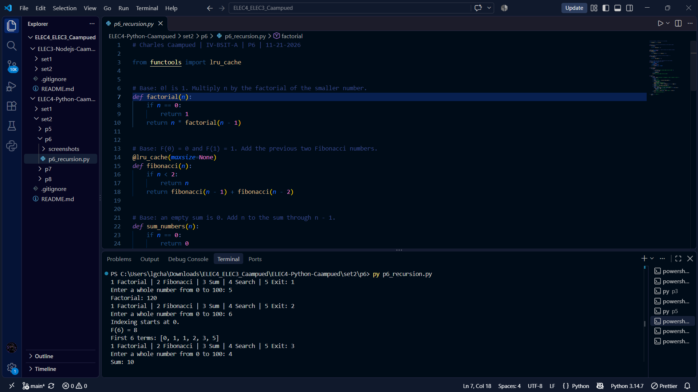
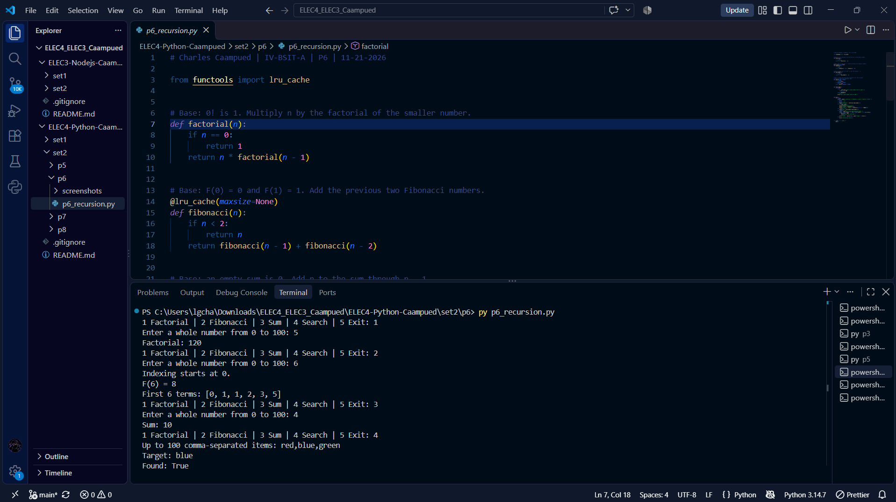

## P7 · Student Management with Classes

```bash
cd set2/p7
py -3 p7_classes.py
```

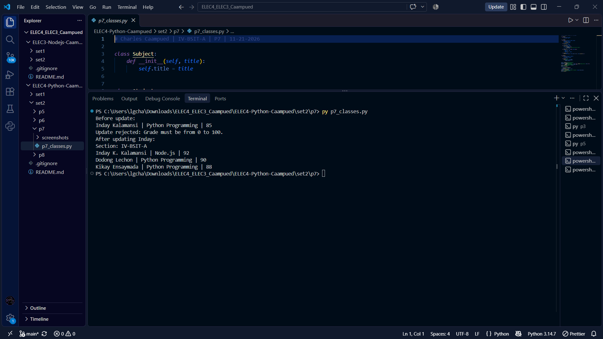

## P8 · Inheritance and Polymorphism

```bash
cd set2/p8
py -3 p8_inheritance.py
```


