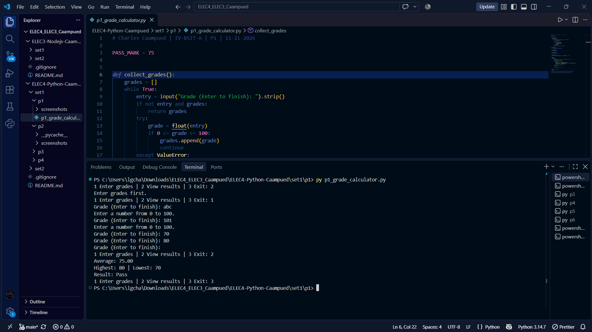
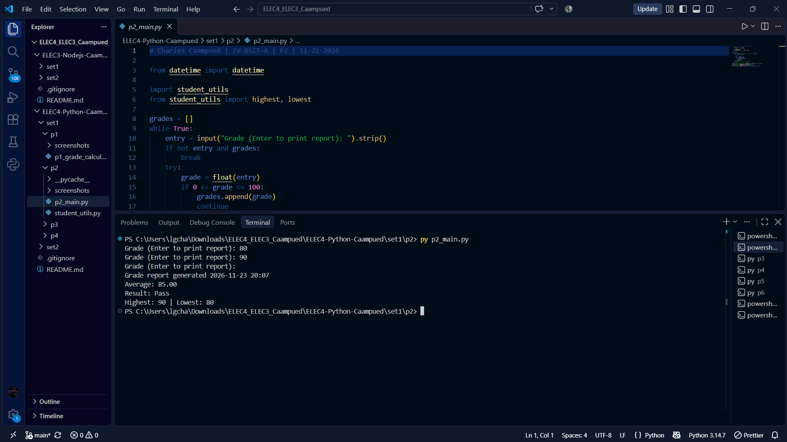
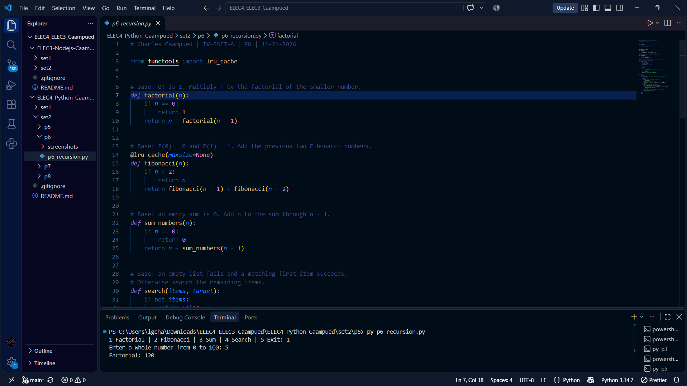
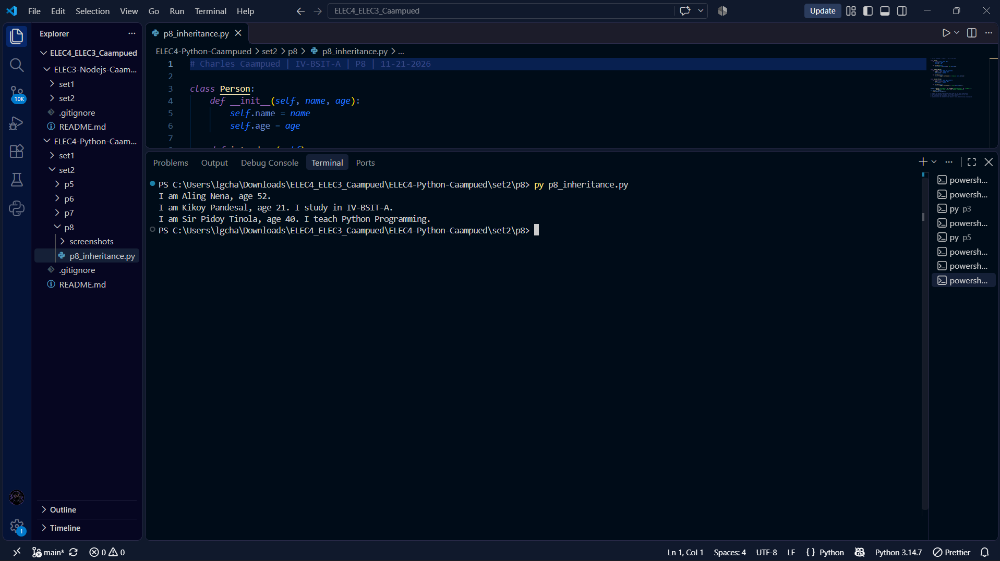

# ELEC 4 – Python Programming

Charles Caampued · IV-BSIT-A · 11-21-2026

Extract the ZIP first. Open this course folder in VS Code and open a fresh PowerShell terminal at the course root for each activity block. Use the Python 3 launcher (py -3). All imports are from Python or the activity folder. In the examples, an arrow separates successive inputs. Enter submits a blank line. Keep the terminal prompt with the Caampued folder visible in screenshots. For API screenshots, name your Postman collection or Thunder Client collection “Charles Caampued”. Save your own PNGs under the filenames shown.

- [P1 · Student Grade Calculator](set1/p1/) — Collect a batch of grades and report its range, average and pass/fail result.
- [P2 · Custom Module](set1/p2/) — Import grade functions and print a dated report.
- [P3 · Student Record Manager](set1/p3/) — Manage names and find students by part of a name.
- [P4 · Safe Menu Program](set1/p4/) — Recover from invalid numbers, zero divisors and file errors.
- [P5 · Student Information File System](set2/p5/) — Save student records beside the script and look them up by ID.
- [P6 · Recursion Toolkit](set2/p6/) — Calculate factorials, Fibonacci numbers and sums, or recursively search a list.
- [P7 · Student Management with Classes](set2/p7/) — Group students by section and validate grade changes.
- [P8 · Inheritance and Polymorphism](set2/p8/) — Call one introduction method across three types of people.

## P1 · Student Grade Calculator

```powershell
Set-Location .\set1\p1
py -3 p1_grade_calculator.py
```

2 → 1 → abc → 101 → 70 → 80 → Enter → 2 → 3. The average is 75 and the result is Pass.

Screenshot checklist (save each view in the activity’s screenshots folder):

- [ ] Results — `results.png`



## P2 · Custom Module

```powershell
Set-Location .\set1\p2
py -3 p2_main.py
```

80 → 90 → Enter. Capture the timestamp and all four results.

Screenshot checklist (save each view in the activity’s screenshots folder):

- [ ] Report — `report.png`



## P3 · Student Record Manager

```powershell
Set-Location .\set1\p3
py -3 p3_record_manager.py
```

1 → Juan Tamad → 1 → juan tamad → 1 → Pedring Tamad → 3 → tamad → 4 → 2 → JUAN TAMAD → 4 → 5. Capture the duplicate message and the list before and after removal.

Screenshot checklist (save each view in the activity’s screenshots folder):

- [ ] Add — `add.png`
- [ ] Duplicate — `duplicate.png`
- [ ] Search — `search.png`
- [ ] Display — `display.png`
- [ ] Remove — `remove.png`


## P4 · Safe Menu Program

```powershell
Set-Location .\set1\p4
py -3 p4_exceptions.py
```

1 → abc → 1 → 8 → 0 → 2 → missing.txt → 9 → 1 → 8 → 2 → 2 → p4_exceptions.py → 3. The program itself is a readable text file.

Screenshot checklist (save each view in the activity’s screenshots folder):

- [ ] Invalid number — `invalid-number.png`
- [ ] Zero — `zero.png`
- [ ] Missing file — `missing-file.png`
- [ ] Invalid choice — `invalid-choice.png`


## P5 · Student Information File System

```powershell
Set-Location .\set2\p5
py -3 p5_file_system.py
```

From the original sample data, try 1 → S106 → Marites Chismosa → BSIT-A → hello → 87 → 2 → 5. Run the same command again. Try 2 → 3 → S106 → 4 → S106 → Marites Chismosa → BSIT-B → 90 → 3 → S106 → 5. For a later run, choose another unused ID.

Screenshot checklist (save each view in the activity’s screenshots folder):

- [ ] Saved — `saved.png`
- [ ] Restart — `restart.png`
- [ ] Search — `search.png`
- [ ] Update — `update.png`


## P6 · Recursion Toolkit

```powershell
Set-Location .\set2\p6
py -3 p6_recursion.py
```

1 → 5 → 2 → 6 → 3 → 4 → 4 → red,blue,green → blue → 5. Expect 120, F(6) = 8 with first six terms [0, 1, 1, 2, 3, 5], a sum of 10 and True.

Screenshot checklist (save each view in the activity’s screenshots folder):

- [ ] Factorial — `factorial.png`
- [ ] Fibonacci — `fibonacci.png`
- [ ] Sum — `sum.png`
- [ ] Search — `search.png`



## P7 · Student Management with Classes

```powershell
Set-Location .\set2\p7
py -3 p7_classes.py
```

Run once. Capture Inday’s original grade, the rejected update, her new grade, name and subject, and the three students.

Screenshot checklist (save each view in the activity’s screenshots folder):

- [ ] Update — `update.png`


## P8 · Inheritance and Polymorphism

```powershell
Set-Location .\set2\p8
py -3 p8_inheritance.py
```

Run once and capture all three introductions.

Screenshot checklist (save each view in the activity’s screenshots folder):

- [ ] Introductions — `introductions.png`



## Submission

Use one public GitHub repository for this course. Work on branches `set-1` and `set-2`, make at least two meaningful commits per activity, and merge one pull request per set. Record one 5–10 minute video for each set. Submit the matching activity folders, video, public repository link and merged pull request link in this course’s Google Drive folder.

| Set | Due |
| --- | --- |
| 1 | November 29, 2026 at 11:59 PM |
| 2 | December 6, 2026 at 11:59 PM |
